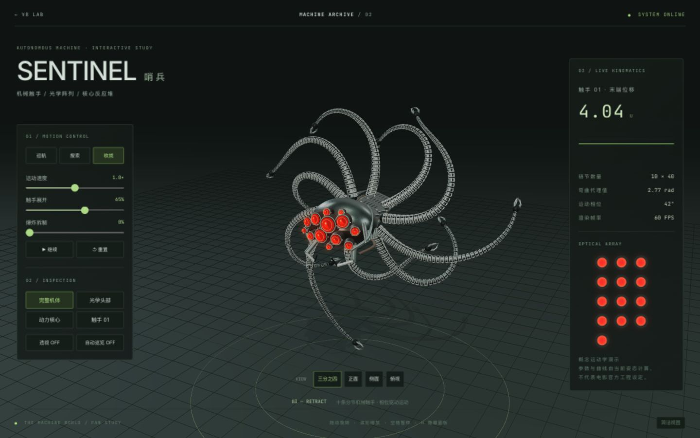

<p align="center"></p>
<h1 align="center">机械档案 · Machine Archive</h1>
<p align="center"><strong>让结构看得见，让机械动起来。</strong><br>V8 八缸发动机与哨兵机器人 · 两套在线可操作、离线可携带的三维演示。</p>
<p align="center"><a href="README.md">简体中文</a> · <a href="README.en.md">English</a> · <a href="https://tuanziding.github.io/v8-interactive-simulator/gallery.html">在线作品集</a></p>
<p align="center"><a href="LICENSE"></a>  </p>
<p align="center"><code>实时交互</code> · <code>结构拆解</code> · <code>巡航运动</code> · <code>配套 Codex 技能</code></p>
<p align="center"><a href="#showcase">成果展示</a> ｜ <a href="#quick-start">快速开始</a> ｜ <a href="#skill">调用技能</a> ｜ <a href="#capabilities">能力状态</a> ｜ <a href="#contribute">参与共创</a></p>
<p align="center"><sub>截图来自实际浏览器运行。V8 为简化教学模型；哨兵为非官方程序化同人模型。</sub></p>

---

<a id="showcase"></a>
## 成果展示

| 作品 | 在线操作 | 下载与源码 |
| --- | --- | --- |
| V8 八缸发动机 | [进入 V8](https://tuanziding.github.io/v8-interactive-simulator/) | [HTML](https://github.com/TUANZIDING/v8-interactive-simulator/releases/download/v1.0.0/v8-engine-v1.0.0.html) · [源码](teardown/sims/v8-shared) |
| 哨兵机器人 | [进入哨兵](https://tuanziding.github.io/v8-interactive-simulator/sentinel.html) | [HTML](https://github.com/TUANZIDING/v8-interactive-simulator/releases/download/v1.0.0/sentinel-v1.0.0.html) · [源码](teardown/sims/sentinel-live) |

<table><tr><td width="50%"><br><strong>发动机剖切</strong>：追踪气缸、转速与实时曲线。</td><td width="50%"><br><strong>哨兵拆解</strong>：金属装甲、400 个链节、13 枚镜头与空间巡航。</td></tr></table>

<a id="quick-start"></a>
## 快速开始

**直接体验：** 打开[在线作品集](https://tuanziding.github.io/v8-interactive-simulator/gallery.html)，选择一套作品。

**离线使用：** 从 [v1.0.0 Release](https://github.com/TUANZIDING/v8-interactive-simulator/releases/tag/v1.0.0) 下载单个 HTML 或完整 ZIP，保存后用支持 WebGL 的现代浏览器打开。页面不依赖 CDN；GitHub 文件预览不会运行 HTML。

**从源码构建：** Node.js 20+。

```sh
git clone https://github.com/TUANZIDING/v8-interactive-simulator.git
cd v8-interactive-simulator
npm ci --prefix teardown
node publish-build.mjs
node preview-site.mjs
```

打开 `http://127.0.0.1:4174/gallery.html`。构建产物在 `docs/`；GitHub Pages 从 main 分支 `/docs` 发布。

## 怎么操作

| 作品 | 控制 |
| --- | --- |
| V8 | 拖动旋转、滚轮缩放；相机预设、GLASS / SECTION / SOLID；选择气缸；转速、播放倍率、暂停与 ±15° 步进 |
| 哨兵 | 巡航 / 搜索 / 收拢；速度、展开、爆炸拆解；头部 / 核心 / 触手隔离；透视、暂停、四个视角 |

哨兵点击巡航后持续游动，机体沿路径转向与侧倾；拆解、隔离时回展示位置。V8 沿用上游闲置 25 秒恢复自动巡演行为。建议桌面宽屏；详细说明见 [操作手册](文档/操作说明v1.0.md)。

<a id="skill"></a>
## 调用生成技能

复用与扩展工作流单独发布在 **[teardown-codex](https://github.com/TUANZIDING/teardown-codex)**，无需复制聊天记录。

```sh
git clone https://github.com/TUANZIDING/teardown-codex.git "${CODEX_HOME:-$HOME/.codex}/skills/teardown-codex"
cd "${CODEX_HOME:-$HOME/.codex}/skills/teardown-codex"
npm run setup
npm run generate -- all --out ./my-machines
```

目录已存在时先检查并更新原安装。新开 Codex 聊天：

> 使用 $teardown-codex，生成 V8 和哨兵的离线交互演示，保留可编辑源码。

可分别选择 `v8`、`sentinel`、`all`；生成器拒绝覆盖已有目录。新机器需要 Agent 建模，不能只换标题。

## 目录

```text
docs/                     # V8、哨兵、作品集、截图与第三方许可
teardown/sims/v8-shared/   # 上游发动机几何、运动和面板
teardown/sims/sentinel-live/ # 哨兵几何、运动、交互及测试
publish-build.mjs         # 构建两套单文件
preview-site.mjs          # 本地预览
previews/ · 文档/          # 实机截图与说明
```

<a id="capabilities"></a>
## 能力状态

| 状态 | 已做与边界 |
| --- | --- |
| 已验证 | 两套单文件构建与 GitHub Pages 部署，主要控件实际操作 |
| 已验证 | 哨兵 480 组链节参数检查、路径朝向、暂停时间冻结与可见位移 |
| 已检查 | 桌面及窄屏布局；性能随硬件变化，不保证所有设备 60 FPS |
| 教学近似 | V8 压力、温度等不能当作工程标定结果；当前示例只显示它实际计算的参数 |
| 概念演示 | 哨兵无电影官方资产、不含刚体碰撞或真实流体推进求解 |
| 未包含 | 本次 Release 不提供音轨或视频导出 |

```sh
node teardown/sims/sentinel-live/motion.test.mjs
```

<a id="contribute"></a>
## 参与共创

欢迎带参考资料的新机构、性能改进或可复现的交互问题。[Issues](https://github.com/TUANZIDING/v8-interactive-simulator/issues) · [更新记录](CHANGELOG.md) · [来源记录](文档/来源记录v1.0.md)

## 许可与引用

[MIT](LICENSE)，保留 elvarofficial/teardown、whaleyxbt/claude-motion、three.js 和字体许可证。哨兵代码为本项目扩展；电影角色与品牌权利归原权利方。许可不等于官方授权。引用见 [CITATION.cff](CITATION.cff)。

<p align="center"><strong>机械档案 · Machine Archive</strong><br><a href="https://github.com/TUANZIDING">TUANZIDING</a> · MIT · v1.0.0</p>
