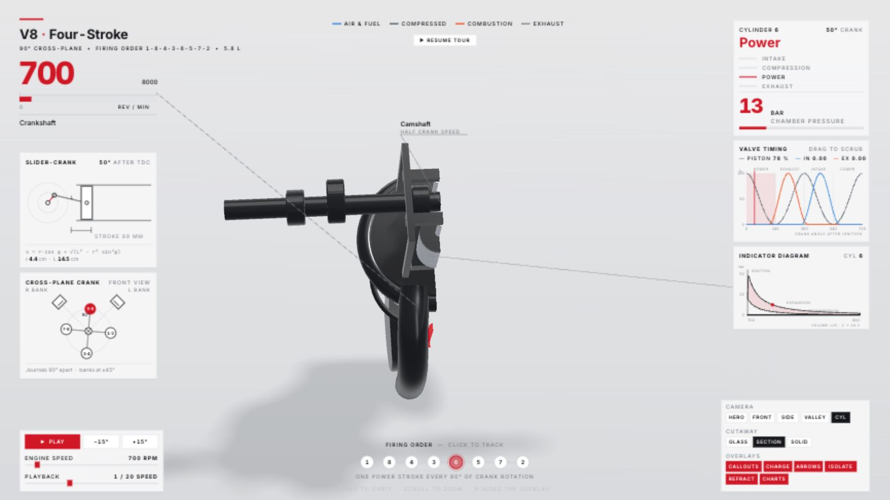

# V8 完整交互版

基于 https://github.com/elvarofficial/teardown 的 V8 开源示例构建，保留原版界面、机械模型和交互逻辑。源码及 MIT 许可保存在 `teardown/`。

**在线演示：https://TUANZIDING.github.io/v8-interactive-simulator/**

## 哨兵机器人 / Sentinel

**[在线体验哨兵机器人](https://tuanziding.github.io/v8-interactive-simulator/sentinel.html)**

受《黑客帝国》哨兵造型启发的程序化 3D 同人演示，非官方模型或电影资产。十条机械触手共 240 个链节，九枚红色光学镜头，分层装甲与发光核心。

- 巡航、搜索、收拢三种运动模式，速度和展开幅度可调。
- 爆炸拆解、透视、头部 / 核心 / 单条触手隔离。
- 四个相机预设、自由旋转缩放、自动巡览、暂停和简洁视图。
- 末端位移与弯曲代理值直接从触手链节点计算；单位为概念模型单位，不代表真实物理测量。
- 生成文件：`docs/sentinel.html`；源码：`teardown/sims/sentinel-live/main.js`。
- 运行 `node publish-build.mjs` 同时构建两套演示；`node preview-site.mjs` 在端口 4174 预览。

## 打开

- 离线：下载并用现代浏览器打开 `docs/index.html`，不需要联网。
- 本地预览：在本目录运行 `node serve-v8.mjs`，然后访问 http://127.0.0.1:4173 。
- 重新构建：进入 `teardown`，运行 `node sims/build.mjs v8-live`。项目依赖已安装在该项目的 `node_modules` 中。
- 首次克隆后：先在 `teardown` 目录运行 `npm ci`；再回到根目录运行 `node publish-build.mjs`，生成含许可证声明的 `docs/index.html`。
- GitHub Pages 从 `main` 分支的 `/docs` 目录发布；更新后需重新构建并提交 `docs`。

## 操作

建议使用桌面浏览器宽屏窗口；手机横屏显示完整控制台。

| 控件 | 功能 |
| --- | --- |
| HERO / FRONT / SIDE / VALLEY / CYL | 总览、正面、侧面、V 型夹角、单缸视角；快捷键 1–5 |
| GLASS / SECTION / SOLID | 透明、剖切、实体显示 |
| CALLOUTS / CHARGE / ARROWS | 零件标注、缸内工质、运动箭头 |
| ISOLATE / REFRACT / CHARTS | 单缸隔离、折射、图表开关 |
| 点火顺序中的气缸编号 | 选择跟踪气缸，仪表同步切换 |
| ENGINE SPEED | 调节发动机转速；上下方向键每次调整 300 RPM |
| PLAYBACK | 调节动画播放倍率，区别于发动机转速 |
| PAUSE / PLAY | 暂停和继续；空格键同效 |
| −15° / +15° | 暂停并逐步转动曲轴；左右方向键同效 |
| 鼠标拖动 / 滚轮 | 环绕观察 / 缩放 |
| H | 隐藏或显示面板 |
| AUTO TOUR / RESUME TOUR | 自动演示 / 手动接管；闲置 25 秒后恢复演示 |

## 已验证

- 构建成功，单文件约 806 KB，内嵌 three.js 和字体。
- 浏览器实际显示 V8、仪表和自动演示；检查了竖屏与 1600×900 桌面布局。
- 主视角、透明显示、单缸剖切、隔离、手动接管和暂停可用。
- 暂停后 +15° 将曲轴从 35° 推进至 50°，压力从 22 bar 变为 13 bar，活塞位置同步从 89% 变为 78%。
- 上方向键调速生效；检查时浏览器无 error/warn 日志。
- 预览截图保存在 `previews/`。

## 模型范围

这是作者的教学可视化模型，不是经过实验标定的发动机工程求解器。压力曲线等数据应按示意模型理解。此版本复现原版 V8 提供的隔离和剖切功能，不额外增加其他机器案例的爆炸拆装功能。

交付为交互网页及 GitHub Pages 静态站点；未生成配乐视频。构建不需要 Python。
